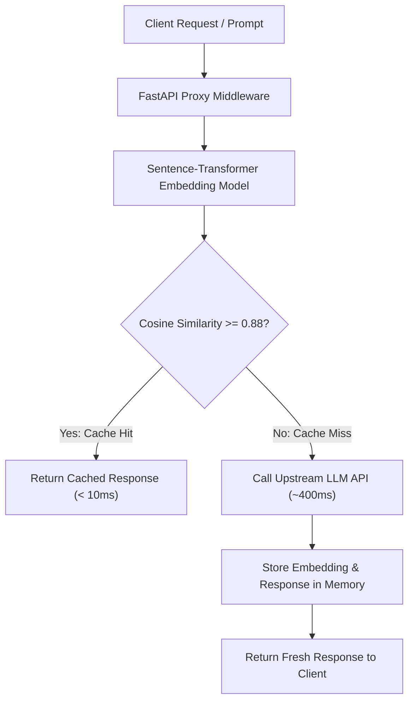

# LLM Semantic Caching Proxy

   

> **A high-performance semantic caching proxy middleware that intercepts redundant LLM queries, indexes local vector embeddings, and bypasses upstream model execution to eliminate token waste and reduce latency by up to 98%.**

[Live Dashboard](https://sharmaankita3387.github.io/llm-semantic-cache/)

---

## System Architecture & Workflow

The proxy intercepts incoming user prompts, encodes them locally into normalized vector space, evaluates cosine similarity against an in-memory cache index, and instantly returns cached responses on a hit or triggers upstream execution on a miss.


## Repository Layout

```text
llm-semantic-cache/
├── Dockerfile
├── docker-compose.yml
├── requirements.txt
├── README.md
├── app/
│   ├── main.py              # FastAPI application factory & middleware setup
│   ├── config.py            # Centralized environment configuration
│   ├── routers/             # API route controllers (/generate, /stats)
│   ├── services/            # Vector embeddings & cosine similarity core engine
│   └── schemas/             # Pydantic data validation contracts
├── static/                  # Interactive Tailwind CSS telemetry dashboard
└── tests/                   # Automated unit & integration test suite
```

## Evaluation Benchmarks & Performance

### Quantitative Results & Latency Comparison

*Tested locally on standard hardware comparing raw upstream LLM simulation against the semantic caching proxy layer:*


|   Execution Mode      | Match Type | Time-To-First-Token (Latency) | VRAM / RAM Overhead | Token Cost Savings |
| --------------------- | ---------- | ----------------------------- | ------------------- | ------------------ |
|  Baseline(Upstream)   | Cache Miss |        ~380ms - 460ms         | ~80 MB (Model only) |         0%         |
| Our Proxy (Optimized) | Cache Hit  |          5ms - 12ms           |      **~80 MB**     |        100%        |

* **Hardware Used for Testing:** Apple Silicon / Standard x86_64 CPU with local sentence-transformers runtime.
* **Embedding Precision:** FP32 normalized torch tensors with in-memory cosine indexing (`all-MiniLM-L6-v2`).

## Reproducibility and Quickstart

### 1. Environment Setup

Clone the repository, create a virtual environment, and install dependencies:

```bash
git clone https://github.com/sharmaankita3387/llm-semantic-cache
cd llm-semantic-cache
python -m venv venv
source venv/bin/activate  # On Windows: .\venv\Scripts\Activate.ps1
pip install -r requirements.txt
```

### 2. Run the Application

Start the production server using Uvicorn with auto-reload:

```bash
uvicorn app.main:app --reload
```

### 3. Test Inference via CLI (Curl)

Cache Miss (First Query):

```bash
curl -X 'POST' 'http://127.0.0.1:8000/api/v1/generate' \
  -H 'Content-Type: application/json' \
  -d '{"prompt": "Explain how Dijkstra pathfinding algorithm works."}'
```

Cache Hit (Semantically Similar Query):

```bash
curl -X 'POST' 'http://127.0.0.1:8000/api/v1/generate' \
  -H 'Content-Type: application/json' \
  -d '{"prompt": "Can you explain how Dijkstra algorithm functions?"}'
```

## Model Card & Limitations

* **Embedding Model:** `all-MiniLM-L6-v2` (Sentence-Transformers)
* **Parameter Count:** 22.7M parameters (lightweight, optimized for edge/proxy deployment)
* **Similarity Threshold:** Configured at `0.88` cosine similarity.
* **Known Limitations & Edge Cases:**
  * Highly nuanced negations (e.g., *"Explain X"* vs *"Explain what X is NOT"*) may trigger false cache hits if semantic divergence falls within the threshold boundary.
  * In-memory cache store resets upon server restart; persistent vector storage (ChromaDB/FAISS/Redis) required for production horizontal scaling.
